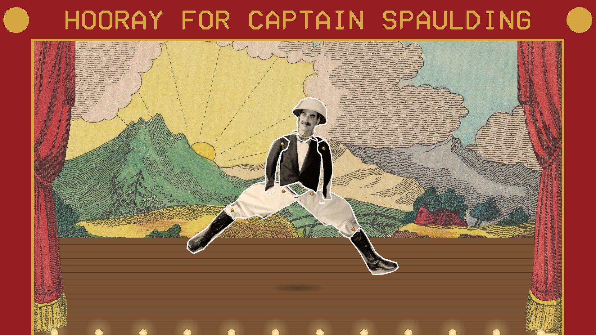
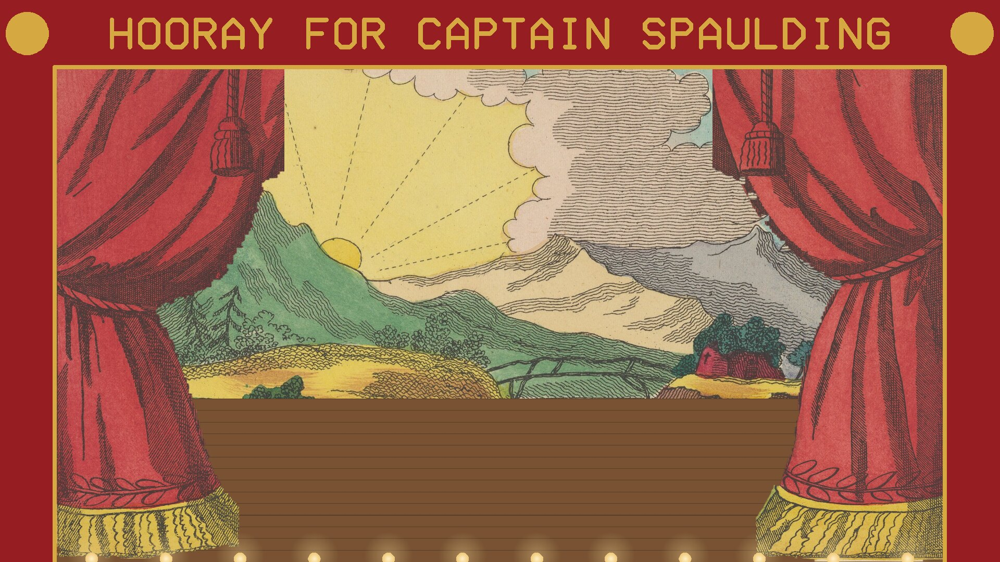
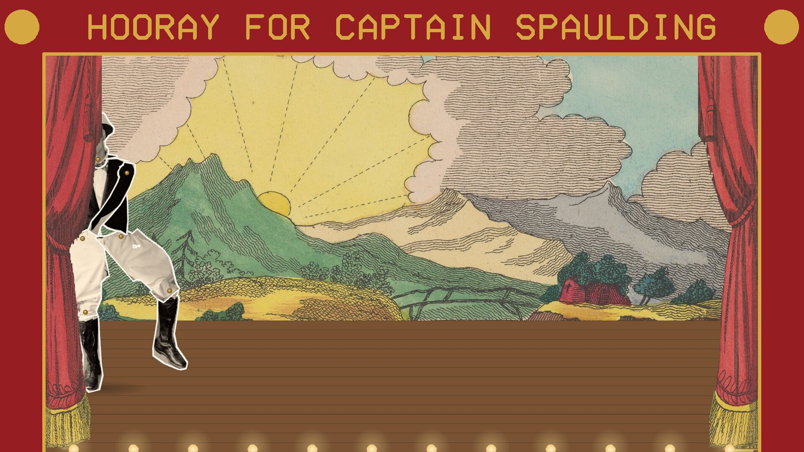
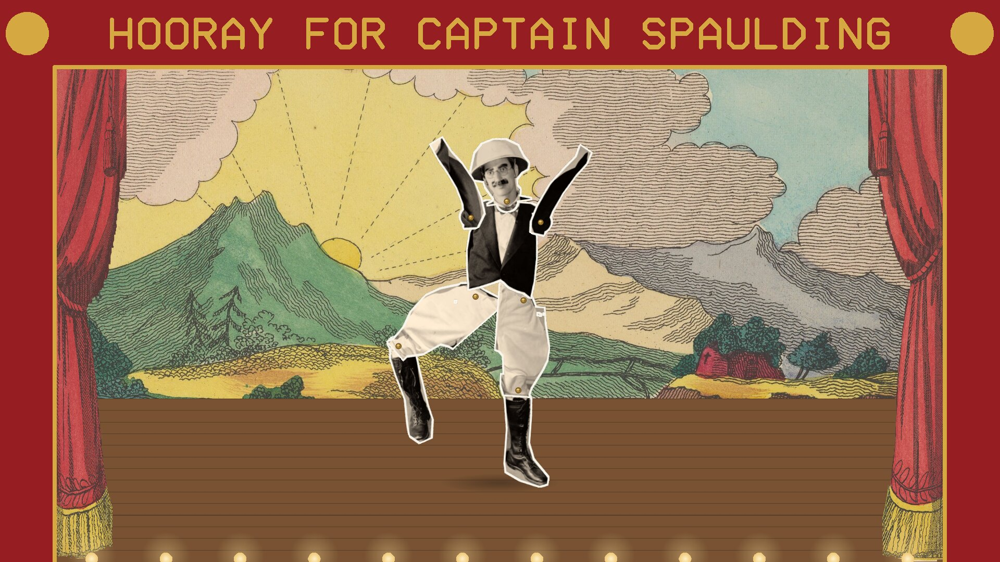
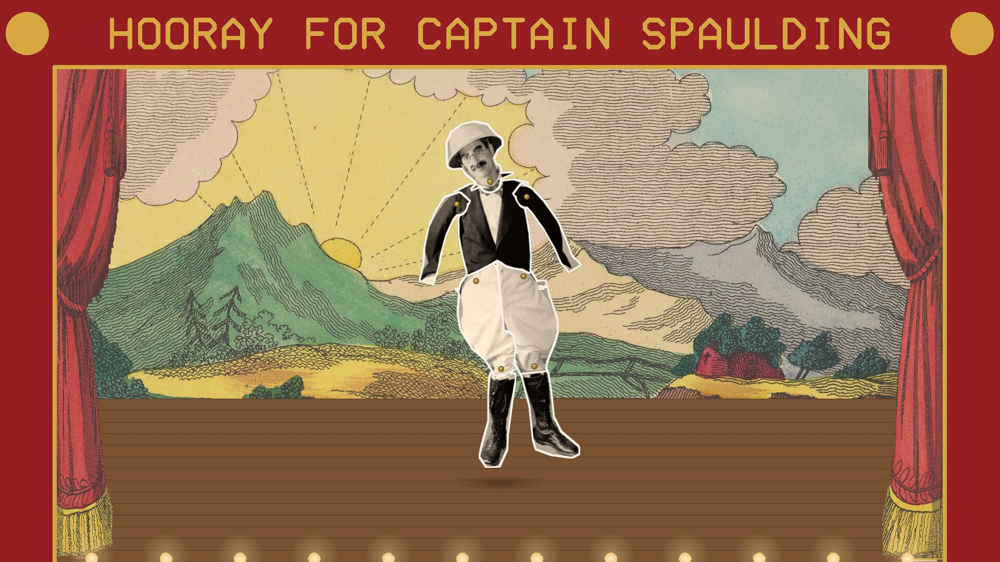

# Hooray for Captain Spaulding

A screensaver of Captain Spaulding, the African explorer of the Marx Brothers'
*Animal Crackers* (1930), as a jointed paper doll on a Victorian toy-theatre stage,
dancing to the song from the film. Runs on Linux, Windows and macOS. One of the
[Marx Brothers screensavers](https://github.com/mottipython/marx-screensavers).

## What it shows

The curtains open on a painted sunrise. He marches on from the wings and marks time
while the chorus sings "Hooray for Captain Spaulding"; through "Hello, I must be
going" he keeps setting off for the wings and coming back; and in his dance he
kicks like a jumping jack with his arms flung up, does a can-can, windmills his
arms, and every so often swings a leg right round its pin. Every move is a quick
jerk on the beat, then a hold, like a paper doll worked by hand.
Then a bow, the curtains close, and it begins again. He keeps time with the music
the whole way: the beats were found from the recording.

| | |
|---|---|
|  |  |
| The curtains open | He marches on |
|  |  |
| Hooray for Captain Spaulding | A leg right round its pin |

## Where it all comes from

Everything in it is in the public domain in the United States.

- **Captain Spaulding** is cut from the 1930 publicity photograph of Groucho Marx in
  the part ([Wikimedia Commons](https://commons.wikimedia.org/wiki/File:Animal_Crackers_Captain_Spaulding.jpg)),
  into head, body, sleeves, thighs and shins, with a white paper edge and brass
  split pins (`tools/outline.py`, `tools/make_doll.py`).
- **The music** is the film's own: Captain Spaulding's arrival, "Hello, I must be
  going", "Hooray for Captain Spaulding" by Bert Kalmar and Harry Ruby, and his
  dance, with the talk between left out (`tools/make_song.py`). The film and the song
  entered the US public domain on 1 January 2026; elsewhere the song may still be in
  copyright.
- **The stage** is from Pollock's toy-theatre scenes for *Jack the Giant Killer*
  (London, about 1850): the backdrop is Scene 4 and the curtains are cut from Scene
  11, from the Metropolitan Museum of Art's prints, released as CC0
  (`tools/make_stage.py`).

## Install

Packages are on the [releases page](../../releases).

### Windows

Run `CaptainSpaulding-Setup-0.1.0.exe`. It asks for administrator rights, because
Windows only lists screensavers that are in its own system folder. After that "Hooray
for Captain Spaulding" is in Screen Saver Settings with the others, already selected.
Uninstall from Apps.

### macOS

For Apple Silicon and Intel, macOS 11 or later. Paste this into Terminal; it installs
the screen saver for your user and opens the Screen Saver settings:

    curl -fsSL https://raw.githubusercontent.com/mottipython/marx-screensavers/main/tools/mac-install.sh | sh -s -- captain-spaulding

Or download the file ending `-mac-screensaver.zip` from the releases page, unzip it
and double-click the `.saver` file. It is not signed with an Apple developer
certificate, so macOS will refuse it at first: open System Settings, Privacy &
Security, and click Open Anyway.

### Linux

**Fedora, Nobara** (built on Fedora 44):

    sudo dnf install ./captain-spaulding-0.1.0-1.fc44.x86_64.rpm

**Debian, Ubuntu, Mint** (Ubuntu 24.04 / Debian 13 or later):

    sudo apt install ./captain-spaulding_0.1.0_amd64.deb

From your next login it starts by itself after five minutes idle on Wayland desktops
that provide ext-idle-notify (KDE Plasma, Sway, Hyprland, niri, COSMIC, labwc and
others), and any key or mouse movement ends it. `captain-spaulding-screensaver`
changes the delay or turns it off. If
[screensaver-service](https://github.com/mottipython/screensaver-service) is
installed, it appears in its list instead.

## Running it yourself

    captain-spaulding              full screen on every display, with the music
    captain-spaulding --window     in a window; Esc or Q quits
    captain-spaulding --mute       without the music
    captain-spaulding --snapshot out.bmp --time 180 --size 1920x1080

## Building

Needs a C compiler, make and SDL2 (2.0.18 or newer). Build from the top of the
source tree, because the pictures and the music in `assets/art` are built into the
program.

    make
    make check

To remake the pictures and music from their sources (the photograph in
`assets/src/spaulding.jpg`, the Met's Scene 4 and Scene 11, and the film):

    tools/make_doll.py
    tools/make_stage.py DIR_WITH_SCENES
    tools/make_song.py "Marx Brothers Animal Crackers (1930).webm"

Packages are written to `dist/`, using the container in `tools/Containerfile`:

    podman build -t anathem-build -f tools/Containerfile tools
    podman run --rm --security-opt label=disable -v "$PWD":/src -w /src anathem-build make dist

## Credits and licence

The code is MIT. An unofficial homage, not connected with the Marx Brothers' estate
or with Paramount or Universal. Images are decoded with
[stb_image](https://github.com/nothings/stb) and the music with stb_vorbis (both
public domain).
